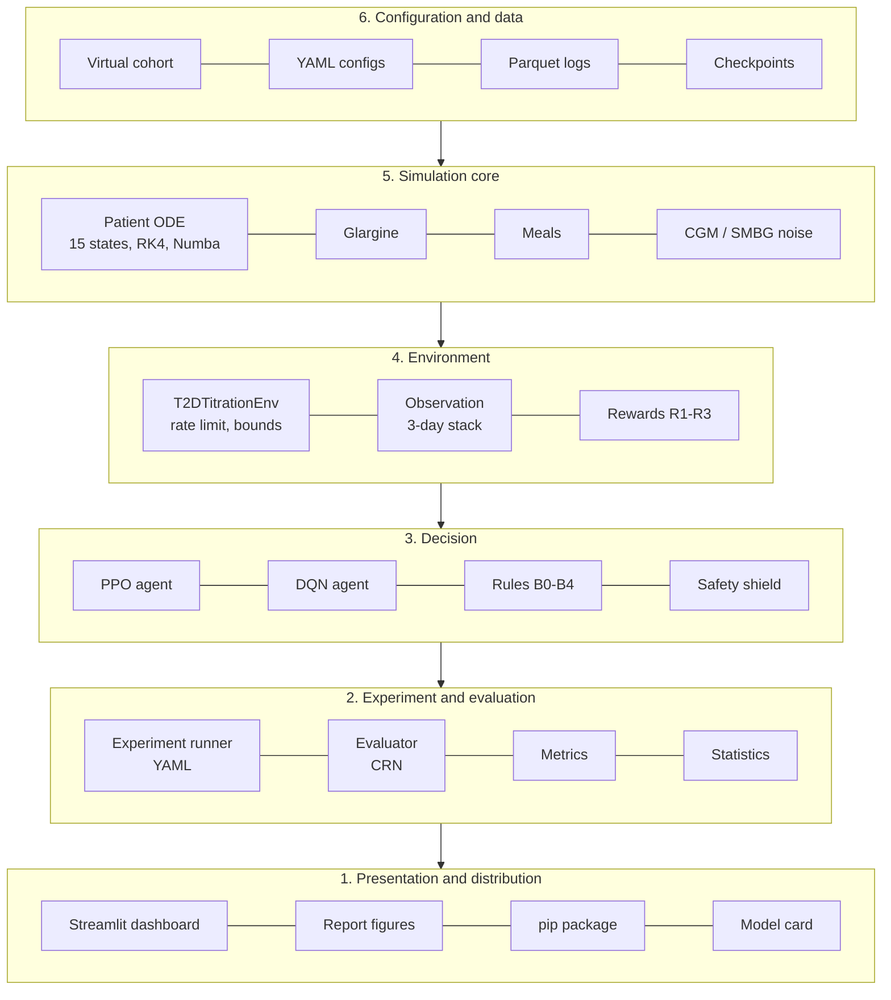

<div align="center">

# TitrateRL

**Simulation-based reinforcement learning for personalized basal insulin titration in Type 2 diabetes**

[](https://github.com/Nodirjn/TitrateRL/actions/workflows/ci.yml)


-orange)

Course project · 4-SRC-10-804 Scientific Research and Communication · Central Asian University

</div>

> [!WARNING]
> **In silico research software only.** TitrateRL is not a medical device. It has not been
> validated or cleared for clinical use, and nothing it produces is medical advice. Never use it
> to choose an insulin dose for a real person. All patients in this project are simulated.

---

## Contents

1. [What this project does](#1-what-this-project-does)
2. [Project status](#2-project-status)
3. [Installation](#3-installation)
4. [Quickstart](#4-quickstart)
5. [How it works](#5-how-it-works)
6. [Reproducing the study](#6-reproducing-the-study)
7. [Repository structure](#7-repository-structure)
8. [Development workflow](#8-development-workflow)
9. [Team and roadmap](#9-team-and-roadmap)
10. [Citation, license and acknowledgements](#10-citation-license-and-acknowledgements)

---

## 1. What this project does

People with Type 2 diabetes (T2D) who start a once-daily long-acting ("basal") insulin, such as
insulin glargine, must have the dose **titrated**: raised step by step until the morning (fasting)
glucose reaches a target. Clinical titration algorithms apply the same fasting-glucose rule to
everyone, which is slow for insulin-resistant patients and risky for insulin-sensitive ones.

TitrateRL asks whether a **reinforcement learning (RL)** agent, trained entirely in simulation,
can titrate faster and more safely than these clinical rules. It provides:

| Component | What it is |
|---|---|
| **Virtual patient simulator** | Open Python implementation of the Dalla Man T2D meal model (15 ODE states, RK4, Numba) with glargine absorption, meals, and CGM/fingerstick noise |
| **Virtual cohort** | 150 heterogeneous adults with T2D (insulin sensitivity, beta-cell function, body weight, fasting glucose), split 90/30/30 |
| **Gymnasium environment** | `TitrateRL/T2D-v0`: one step = one day, one episode = 24 weeks; weekly rate limit and dose bounds |
| **Agents and baselines** | PPO (primary) and DQN (Stable-Baselines3) with a rule-based safety shield; clinical algorithms AT.LANTUS, Treat-to-Target and INSIGHT |
| **Evaluation pipeline** | Consensus glycemic metrics, common random numbers, pre-specified statistics (Wilcoxon, Holm, Hodges–Lehmann, bootstrap) |
| **Dashboard** | Streamlit app to compare up to three policies on a virtual test patient |

### Research questions

| | Question | Hypothesis |
|---|---|---|
| **RQ1** | How does the reward (R1 time in range, R2 risk index, R3 time in range with hypoglycemia penalties) change the efficacy–safety trade-off? | H1: R3 lowers time below 70 mg/dL at comparable time in range |
| **RQ2** | Does a shielded PPO policy beat clinical titration algorithms on unseen patients? | H2: ≥ 5 pp more maintenance-phase time in range, non-inferior hypoglycemia (1 pp margin) |
| **RQ3** | Does the benefit depend on (hidden) insulin sensitivity, and does one policy personalize? | H3: negative correlation with insulin sensitivity; larger dose increases for insulin-resistant patients |

---

## 2. Project status

The project follows the 14-week plan of the proposal. **The software for every MVP feature
is implemented and tested; the experiments (agent training, test-cohort evaluation) have not been
run yet.** No research results exist so far.

| Feature (proposal Table IX) | Status |
|---|---|
| F1 Simulator + calibrated cohort | ✅ implemented · ⚠️ calibration check V4 **not yet passed** (final dose ✅, fasting glucose too low), see [docs/validation.md](docs/validation.md) |
| F2 Gymnasium environment | ✅ passes `check_env`; one 168-day episode ≈ 0.15 s (target < 2 s) |
| F3 Trained agents | ✅ training pipeline + configs · ⏳ runs not started (Weeks 7–10) |
| F4 Rule-based policies B0–B4 | ✅ unit tests reproduce the published titration steps |
| F5 Evaluation pipeline | ✅ one command regenerates tables, tests and figures |
| F6 Interactive dashboard | ✅ implemented |
| F7 Installable package | ✅ `pip install -e .`, environment registered as `TitrateRL/T2D-v0` |

Decision gate **G1** (simulator validation, end of Week 5): V1 ✅, V2 ✅, V3 documented, V4 ❌,
V5 documented. Run `titraterl validate` for the current report.

---

## 3. Installation

Requirements: Python ≥ 3.10, about 2 GB of disk for PyTorch (CPU build is enough).

```bash
git clone https://github.com/Nodirjn/TitrateRL.git
cd TitrateRL
python -m venv .venv
source .venv/bin/activate            # Windows: .venv\Scripts\activate
pip install --upgrade pip
pip install -e ".[dev,dashboard]"    # package + test tools + Streamlit
```

CPU-only PyTorch (smaller download):

```bash
pip install torch --index-url https://download.pytorch.org/whl/cpu
pip install -e ".[dev,dashboard]"
```

Or install the package only, without cloning:

```bash
pip install "titraterl @ git+https://github.com/Nodirjn/TitrateRL.git"
```

Check the installation:

```bash
pytest -m "not slow"                 # ~80 tests, < 1 min
titraterl simulate --policy b2_treat_to_target
```

---

## 4. Quickstart

### Command line

```bash
titraterl cohort --out data/cohort.parquet           # generate the 150-patient cohort
titraterl validate --out reports                     # simulator checks V1-V5 (gate G1)
titraterl simulate --policy b1_atlantus --patient T2D-017
titraterl train --config configs/train/smoke.yaml    # 1-minute smoke training run
titraterl evaluate --config configs/eval/baselines_quick.yaml
titraterl dashboard                                  # opens the Streamlit app
```

### Python API

```python
import gymnasium as gym
import titraterl  # registers TitrateRL/T2D-v0

env = gym.make("TitrateRL/T2D-v0", reward="r3", obs_mode="full")
obs, info = env.reset(seed=0)
print(info["patient_id"], info["dose_u"], info["fasting_smbg"])

terminated = truncated = False
while not (terminated or truncated):
    action = env.action_space.sample()      # 0..4  ->  -4, -2, 0, +2, +4 U
    obs, reward, terminated, truncated, info = env.step(action)
print("final dose", info["dose_u"], "U")
```

Compare a clinical algorithm with no titration on the same scenarios (common random numbers):

```python
from titraterl.cohort import default_cohort
from titraterl.evaluation import evaluate, per_patient
from titraterl.policies import FixedDose, TreatToTarget

cohort = default_cohort()
df, _ = evaluate([FixedDose(), TreatToTarget()], cohort, cohort.split("val")[:5], n_scenarios=2)
print(per_patient(df).groupby("policy_id")[["maintenance_tir", "full_tbr70"]].median())
```

More examples: [`examples/quickstart.py`](examples/quickstart.py) and
[`examples/quickstart.ipynb`](examples/quickstart.ipynb).

---

## 5. How it works

### Architecture

Six layers; each depends only on the layers below it, so the physiological model, the agents and
the interface can be replaced independently (details: [docs/architecture.md](docs/architecture.md)).



### The decision problem (proposal Table V)

| Element | Definition |
|---|---|
| Step | One day, 07:00 → 07:00. Bedtime injection at 21:00; fasting fingerstick at 07:00 |
| Episode | 168 days (24 weeks), as in the reference trials; starts at 10 U |
| Observation | Last 3 days × 11 features (fasting SMBG, dose/kg, last change, CGM TIR/TBR/TAR/mean/CV, hypoglycemia events in 72 h, body weight, time) = 33 values in [0, 1]. FPG-only variant: 18 values |
| Action | Dose change ∈ {−4, −2, 0, +2, +4} U |
| Constraints (all policies) | Cumulative increase ≤ 8 U over any 7 days; dose ∈ [0, 1.0 U/kg] |
| Rewards | R1 = TIR · R2 = −mean risk / 100 · R3 = TIR − 5·TBR<70 − 10·TBR<54 (daily CGM) |
| Safety shield (RL only) | Level-1 hypo in 72 h → no increase; level-2 hypo in 24 h → −20 % dose |

### Baselines

| ID | Policy | Rule |
|---|---|---|
| B0 | No titration | 0.2 U/kg/day constant |
| B1 | AT.LANTUS (Davies 2005) | +2 U every 3 days if 3-day mean fasting > 100 mg/dL |
| B2 | Treat-to-Target (Riddle 2003) | Weekly +2/+4/+6/+8 U by 2-day mean fasting; −4 U after < 56 mg/dL |
| B3 | INSIGHT (Gerstein 2006) | +1 U per day while fasting > 100 mg/dL |
| B4 | Simulator-tuned rule | Best of 36 threshold rules (Should tier) |

Full details: [docs/environment.md](docs/environment.md), [docs/baselines.md](docs/baselines.md),
[docs/model.md](docs/model.md).

---

## 6. Reproducing the study

The experimental protocol is Algorithm 1 of the proposal. Every experiment is a YAML file in
[`configs/`](configs); results are stored with the commit hash that produced them.

```bash
# Gate G1 - simulator validation (must pass before training)
titraterl validate --strict

# Phase 1 (RQ1): three rewards x five seeds, shield off  ->  15 runs
for cfg in ppo_r1 ppo_r2 ppo_r3; do
  for s in 0 1 2 3 4; do titraterl train --config configs/train/$cfg.yaml --seed $s; done
done

# Phase 2 (RQ2): primary policy = PPO with the selected reward R* and the shield
#   edit `reward` in configs/train/ppo_rstar_shield.yaml first
for s in 0 1 2 3 4; do titraterl train --config configs/train/ppo_rstar_shield.yaml --seed $s; done

# Phase 3: evaluation on 30 test patients x 10 scenarios (add checkpoints to the config)
titraterl evaluate --config configs/eval/test.yaml
```

| Output | Location |
|---|---|
| Trained models, selection history, run metadata | `runs/<run_name>_s<seed>/` |
| Episode metrics, per-patient table, summary | `results/<name>/episodes.parquet`, `per_patient.csv`, `summary.csv` |
| H2 decision table | `results/<name>/h2.json` |
| Figures | `results/<name>/figures/*.png` |
| Validation report | `reports/validation.md`, `validation.json` |

Compute budget: one 10⁶-step PPO run takes about 25–40 min on one CPU core (measured ≈ 690
environment steps/s with 8 vectorized environments). The 20 Core runs need roughly 15 CPU-hours.

Metrics and statistics: [docs/evaluation.md](docs/evaluation.md). Log format:
[docs/data_dictionary.md](docs/data_dictionary.md).

---

## 7. Repository structure

```text
TitrateRL/
├── src/titraterl/
│   ├── simulation/        # L5  parameters, ODE + RK4 (Numba), meals, sensors, VirtualPatient
│   ├── cohort/            # L6  virtual cohort generator, split, Parquet I/O
│   ├── envs/              # L4  T2DTitrationEnv, observation, rewards, SafetyShield
│   ├── policies/          # L3  Policy interface, rules B0-B4, SB3 adapter
│   ├── training/          # L3  PPO/DQN training, checkpoint-selection callback
│   ├── metrics/           # L2  glycemic and episode metrics
│   ├── evaluation/        # L2  CRN runner, statistics, Parquet logs, pipeline
│   ├── validation/        # G1  simulator checks V1-V5
│   ├── config.py          # YAML experiment configuration
│   └── cli.py             # `titraterl` command
├── dashboard/app.py       # L1  Streamlit dashboard
├── configs/               # cohort, training and evaluation YAML files
├── tests/                 # unit + integration tests (pytest)
├── docs/                  # architecture, model, environment, evaluation, validation, ...
│   └── course/            # course reports (Week 10 IEEE report)
├── examples/              # quickstart script and notebook
├── .github/               # CI workflow, issue and pull-request templates
├── MODEL_CARD.md          # intended use and limitations
└── pyproject.toml         # packaging, ruff, pytest configuration
```

---

## 8. Development workflow

* **Process:** Scrum-inspired two-week sprints; backlog in GitHub Projects; supervisor review at
  the end of every sprint. Milestones M1–M4 coincide with sprint reviews.
* **Branching:** GitHub Flow. `main` is protected; work on short-lived branches
  (`feat/…`, `fix/…`, `docs/…`); every pull request needs green CI and one approving review.
* **Commits:** [Conventional Commits](https://www.conventionalcommits.org/)
  (`feat(env): add weekly rate limit`).
* **Quality:** test-driven development with `pytest`; `ruff` for linting and formatting;
  `pre-commit` runs both before every commit.
* **Releases:** tags `v0.1-env` (M1), `v0.2-agents` (M2), `v0.3-eval` (M3), `v1.0-mvp` (M4).

```bash
pre-commit install          # once
make lint test              # what CI runs
make test-all               # including slow tests (training smoke run)
```

See [CONTRIBUTING.md](CONTRIBUTING.md) and [docs/development.md](docs/development.md).

---

## 9. Team and roadmap

| Member | ID | Area |
|---|---|---|
| Boburmirzo Uchqunov | 240447 | Software engineering: environment package, CI, dashboard |
| Nodirjon Khabibullaev | 230019 | Literature, evaluation and statistical analysis |
| Ibrohim Abralov | 230129 | Physiological simulator, virtual cohort and validation |
| Abdurashid Abdusattarov | 221229 | RL agents, reward design and safety shield |

Supervisor: Dr. Eugene Castro.

| Weeks | Deliverable | Milestone |
|---|---|---|
| 1–3 | Requirements, repository and CI, patient model, glargine model | |
| 4–6 | Cohort calibration, environment, baselines, gate G1 | **M1** `v0.1-env` |
| 7–8 | PPO with R1–R3, reward selection, gate G2 | **M2** `v0.2-agents` |
| 9–10 | Evaluation pipeline, dashboard v1, shielded PPO; RQ1 answered | |
| 11–12 | Test-cohort evaluation (RQ2), packaging; Week 12 buffer | **M3** `v0.3-eval` |
| 13 | RQ3 analyses | |
| 14 | Final report, release, presentation | **M4** `v1.0-mvp` |

Details and owners: [docs/roadmap.md](docs/roadmap.md).

---

## 10. Citation, license and acknowledgements

If you use TitrateRL, please cite it using [CITATION.cff](CITATION.cff).

Released under the [MIT License](LICENSE).

* The glucose, insulin and gut subsystems follow Dalla Man, Rizza and Cobelli,
  *Meal simulation model of the glucose-insulin system*, IEEE TBME 54(10), 2007, and are verified
  against the open-source [simglucose](https://github.com/jxx123/simglucose) (MIT license)
  implementation, which is used only as a test reference.
* Clinical titration rules follow Riddle et al. (2003), Davies et al. (2005) and Gerstein et al.
  (2006); metrics follow the international time-in-range consensus (Battelino et al., 2019).

See [MODEL_CARD.md](MODEL_CARD.md) for intended use and known limitations.
