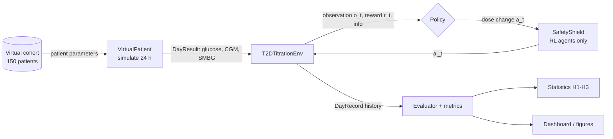
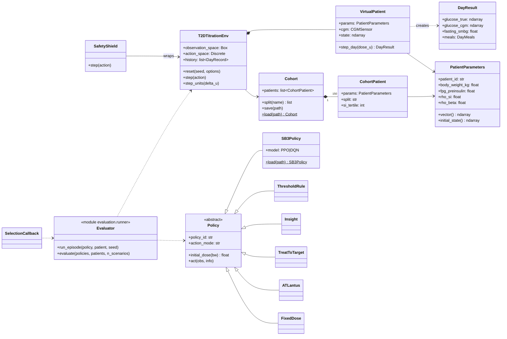

# Architecture

TitrateRL follows a **layered architecture**: each layer depends only on the layers below it.
This makes it possible to replace the physiological model, the agents or the user interface
independently (proposal Section IV-B, Fig. 1).

| Layer | Package | Responsibility |
|---|---|---|
| 1. Presentation and distribution | `dashboard/`, `pyproject.toml`, `MODEL_CARD.md` | Streamlit dashboard, report figures, pip package, model card |
| 2. Experiment and evaluation | `titraterl.evaluation`, `titraterl.metrics`, `titraterl.config` | YAML experiments, CRN evaluator, metrics, statistical tests |
| 3. Decision | `titraterl.policies`, `titraterl.training`, `titraterl.envs.wrappers` | PPO/DQN agents, rule-based policies B0–B4, safety shield |
| 4. Environment | `titraterl.envs` | `T2DTitrationEnv`: rate limit, dose bounds, observation, reward |
| 5. Simulation core | `titraterl.simulation` | Patient ODE (RK4, Numba), glargine absorption, meals, sensor noise |
| 6. Configuration and data | `titraterl.cohort`, `configs/`, `runs/`, `results/` | Virtual cohort, YAML configs, checkpoints, Parquet logs |

## Data flow

## Daily state loop

1. `reset()` samples a patient and a scenario seed, sets the starting dose `d_0` (10 U), and
   simulates day 0.
2. The policy receives the 3-day observation stack (and, for rules, the `info` dict) and proposes
   a dose change `a_t`.
3. For RL agents with the shield enabled, `SafetyShield` filters `a_t` from measured hypoglycemia.
4. The environment applies the weekly rate limit (≤ 8 U per 7 days) and dose bounds
   `[0, 1.0 U/kg]`: `d_{t+1} = d_t + a'_t`.
5. `VirtualPatient.step_day` integrates 1440 one-minute RK4 steps: meals, injection at 21:00,
   CGM every 5 minutes, fingerstick at 07:00.
6. Daily metrics and the reward are computed; the day is logged; repeat until day 167.

## Class diagram

## Design decisions

* **Flat parameter vector + Numba.** The ODE right-hand side and the 1-minute RK4 loop are compiled
  with Numba in `nopython` mode, with the parameter and state layouts defined in
  `simulation/parameters.py` (`P`, `S`). A test checks that the compiled index constants match the
  layout. Set `TITRATERL_DISABLE_JIT=1` to debug in pure Python.
* **One day = one environment step**, from 07:00 to 07:00. The fasting fingerstick at the end of
  a day therefore reflects the night after that day's injection, which is what clinical rules use.
* **Common random numbers.** Each `VirtualPatient` spawns three independent random streams (meals,
  CGM noise, SMBG noise) from one scenario seed, so all policies see identical meals and noise.
* **Constraints in the environment, shield in a wrapper.** The rate limit and dose bounds apply to
  every policy; the shield applies only to RL agents and is a separate Gymnasium wrapper.
* **One `Policy` interface** for rules and RL agents, so the evaluator, the dashboard and the
  statistics code treat them identically.
