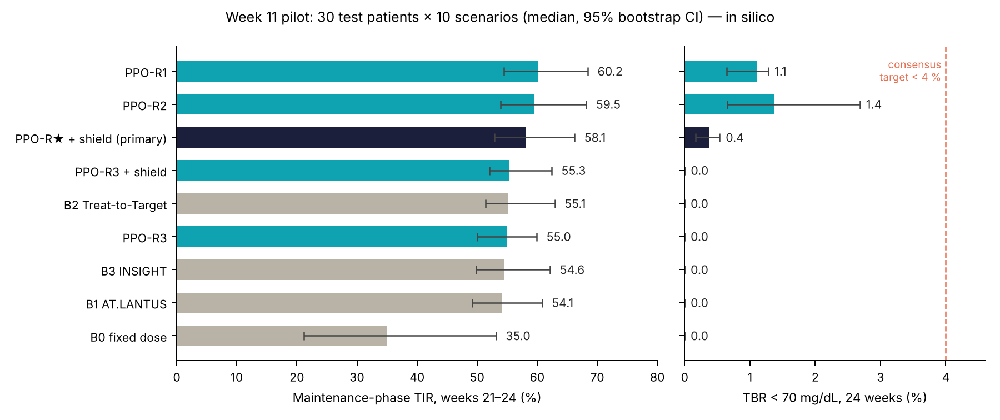
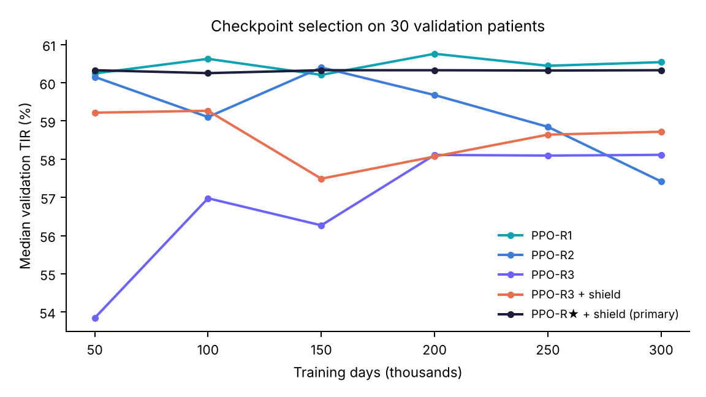

# Week 11 pilot evaluation

**Status: preliminary.** Agents were trained with 3 × 10⁵ simulated days (30 % of the planned
10⁶) and one seed (planned: five). The evaluation itself follows the full protocol: 30 held-out
test patients × 10 scenarios of 24 weeks, common random numbers, noise-free endpoints and the
pre-specified statistics. In silico results, not medical advice.

Reproduce (about 6 minutes on two CPU cores):

```bash
titraterl evaluate --config configs/eval/test_pilot.yaml
```





## Reward selection (phase 1, validation patients)

| Reward | Median validation TIR | Patients meeting TBR targets | Qualifies (≥ 90 %) |
|---|---|---|---|
| R1 (time in range) | 60.8 % | 93 % | yes — **selected as R★** |
| R2 (risk index) | 60.2 % | 90 % | yes |
| R3 (TIR with hypoglycemia penalties) | 58.1 % | 100 % | yes |

## Test-cohort results

Split: **test**, 30 patients x 10 scenarios (common random numbers). Endpoints from noise-free glucose. In silico results - not medical advice.

| Policy | Maintenance TIR % (95% CI) | TBR<70 % (95% CI) | TBR<54 % | Final dose U/kg | Meets targets |
|---|---|---|---|---|---|
| ppo_r1_s0 | 60.2 (54.5-68.5) | 1.1 (0.6-1.3) | 0.0 | 0.65 | 93.3% |
| ppo_r2_s0 | 59.5 (53.9-68.2) | 1.4 (0.7-2.7) | 0.0 | 0.64 | 86.7% |
| ppo_rstar_shield_s0 | 58.1 (52.9-66.2) | 0.4 (0.2-0.5) | 0.0 | 0.58 | 100.0% |
| ppo_r3_shield_s0 | 55.3 (52.0-62.4) | 0.0 (0.0-0.0) | 0.0 | 0.54 | 100.0% |
| b2_treat_to_target | 55.1 (51.4-63.0) | 0.0 (0.0-0.0) | 0.0 | 0.51 | 100.0% |
| ppo_r3_s0 | 55.0 (50.1-59.9) | 0.0 (0.0-0.0) | 0.0 | 0.50 | 100.0% |
| b3_insight | 54.6 (49.8-62.2) | 0.0 (0.0-0.0) | 0.0 | 0.52 | 100.0% |
| b1_atlantus | 54.1 (49.2-60.8) | 0.0 (0.0-0.0) | 0.0 | 0.51 | 100.0% |
| b0_fixed | 35.0 (21.2-53.2) | 0.0 (0.0-0.0) | 0.0 | 0.20 | 100.0% |

## H1 (RQ1)

ppo_r3_s0 vs ppo_r1_s0: one-sided Wilcoxon p = 0.0000; median TIR loss 5.1 pp; supported: **False**

## H2 (RQ2)

| Baseline | HL TIR gain (pp) | p (Holm) | mean TBR diff (pp) | upper CI (pp) | supported |
|---|---|---|---|---|---|
| b1_atlantus | 3.7 | 0.0000 | 0.40 | 0.53 | **False** |
| b2_treat_to_target | 2.1 | 0.0000 | 0.40 | 0.53 | **False** |
| b3_insight | 2.9 | 0.0000 | 0.40 | 0.53 | **False** |

## H3 (RQ3)

ppo_rstar_shield_s0 vs b2_treat_to_target: Spearman rho = -0.160, one-sided p = 0.1999; supported: **False**

| SI tertile | n | median TIR difference (pp) |
|---|---|---|
| 1 | 10 | 2.4 |
| 2 | 10 | 1.5 |
| 3 | 10 | 1.8 |

## Interpretation (preliminary)

* **RQ2 / H2.** The primary policy (PPO-R★ = R1 with the safety shield) reached a median
  maintenance TIR of 58.1 % versus 54.1–55.1 % for the three clinical algorithms. The gain is
  statistically significant against all three after Holm adjustment (Hodges–Lehmann
  3.7, 2.1 and 2.9 pp)
  and hypoglycemia is non-inferior (upper 95 % CI of the TBR<70 difference
  0.53 pp < 1 pp margin), but the gain is below the pre-specified
  clinically meaningful threshold of 5 pp, so H2 is **not supported** at this stage.
* **RQ1 / H1.** R3 lowered TBR<70 compared with R1 (p < 0.001) but at a median TIR cost of
  5.1 pp, just above the 5 pp tolerance, so H1 is **not supported**. R1 policies stay within the
  consensus hypoglycemia targets for 93 % of patients without a shield; the shield removes most of
  the remaining hypoglycemia (TBR<70 1.1 % → 0.4 %) at a cost of 2 pp TIR.
* **RQ3 / H3.** The benefit over Treat-to-Target is positive in every insulin-sensitivity
  tertile (1.5–2.4 pp) with a weak, non-significant negative correlation with insulin sensitivity
  (Spearman ρ = −0.16, p = 0.20). H3 is **not supported** at this stage.
* **Clinical baselines** produce almost no hypoglycemia in the current simulator (see V4 and the
  missing counter-regulation in [../validation.md](../validation.md)), which limits how much a
  learned policy can gain by titrating faster.

## Next steps (Weeks 11–12)

1. Full protocol: 10⁶ training days, seeds 0–4 for PPO-R1/R2/R3 and the primary policy.
2. Should-tier runs: DQN, FPG-only PPO, λ grid for R3.
3. Calibration (V4) refinement, then re-run of the evaluation; report both versions.
4. RQ3 dose-behavior analysis at matched fasting glucose and the train–test generalization gap.
